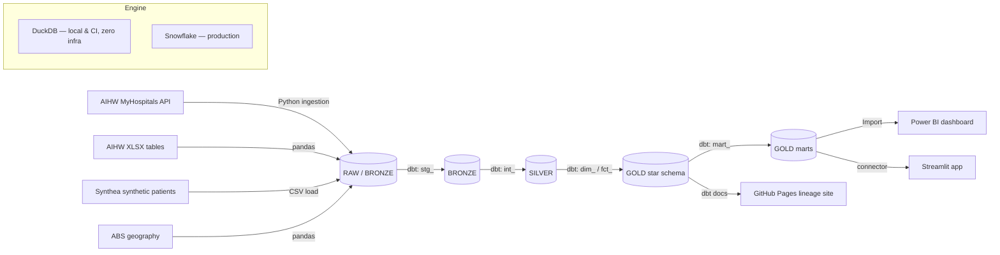

# 🏥 LittleVitals — Melbourne Health-System Analytics Platform

> End-to-end modern data stack analytics over Victorian & Australian public health
> system performance data, with a paediatric lens — built with **dbt**, **DuckDB /
> Snowflake**, **Power BI**, and **Python**.

[](https://www.getdbt.com/)
[](https://duckdb.org/)
[](https://www.snowflake.com/)
[](LICENSE)

---

## ✅ Run it locally in 2 minutes — no cloud accounts required

The entire warehouse builds and tests on **DuckDB** with committed synthetic
fixtures, so anyone can clone and run the full pipeline offline. The same dbt
models target **Snowflake** in production (see [`profiles.yml`](littlevitals_dbt/profiles.yml)).

```powershell
# Windows / PowerShell
python -m venv .venv
.\.venv\Scripts\Activate.ps1
pip install -r requirements.txt

python data\sample\generate_sample_data.py                 # regenerate fixtures (seed=42)
dbt deps  --project-dir littlevitals_dbt --profiles-dir littlevitals_dbt
dbt build --project-dir littlevitals_dbt --profiles-dir littlevitals_dbt   # run + test everything
dbt docs generate --project-dir littlevitals_dbt --profiles-dir littlevitals_dbt
dbt docs serve    --project-dir littlevitals_dbt --profiles-dir littlevitals_dbt   # browse lineage
```

Or just `make build` (see [`Makefile`](Makefile) / [`make.ps1`](make.ps1)).

**Current build status:** `dbt build` → **118 nodes PASS, 0 errors** (17 models —
2 facts + 6 dims + marts, enforced contracts, 1 unit test, source-vs-Gold
reconciliation, ~90 data tests).

---

## 📐 Architecture



The medallion layers (**BRONZE → SILVER → GOLD**) and a Kimball **star schema** in
Gold are engine-agnostic: identical dbt models run on DuckDB (local/CI) and
Snowflake (prod) via a single `target.type` switch.

---

## 🗂️ Highlights

- **DuckDB-first, Snowflake-ready** — the whole pipeline runs offline & free for
  local dev and CI; production swaps to Snowflake with no model changes.
- **Medallion + Kimball star schema** — `stg_` → `int_` → `dim_`/`fct_` → `mart_`.
- **Enforced dbt contracts** on every Gold model (schema drift fails the build).
- **dbt unit test** of transformation logic + **reconciliation test** proving Gold
  totals tie back to source within tolerance.
- **Australian financial-year** date dimension and FY-aware logic (1 Jul – 30 Jun).
- **Insider health domain** baked into seeds & docs: ACEM triage targets, the
  4-hour rule (NEAT) nuance, elective urgency clinical day-targets.
- **Honest by design** — synthetic data clearly labelled; a real limitations
  section; see [`CLAUDE.md`](CLAUDE.md) §25.

---

## 📊 Key questions this answers

1. Which Victorian hospitals are missing the Category 2 ED on-time benchmark, and by how much?
2. How has ED on-time performance trended (2020-21 → 2024-25) versus the national benchmark?
3. How does each hospital's median wait compare to the national median (variance)?
4. Which hospitals are "Meets / At Risk / Below Benchmark" on the executive scorecard?
5. (Paediatric layer — next phase) Top paediatric diagnoses & seasonal ED surge.

---

## 🛠️ Tech stack

| Layer | Technology |
|---|---|
| Warehouse (prod) | Snowflake |
| Warehouse (local/CI) | DuckDB (`dbt-duckdb`) |
| Transformation | dbt Core 1.11 (contracts, unit tests, docs) |
| Ingestion | Python 3.13 (pandas, requests, snowflake-connector) |
| BI | Power BI Desktop + Service (DAX, RLS, paginated report) |
| Companion app | Streamlit (Plotly) |
| Data science | statsmodels, scikit-learn, lifelines, scipy |
| CI/CD & quality | GitHub Actions, sqlfluff, pre-commit |
| Sources | AIHW MyHospitals · AIHW XLSX · Synthea · ABS |

---

## 🗄️ Data sources & synthetic-data disclaimer

| Source | What | Status |
|---|---|---|
| AIHW MyHospitals | ED waiting times, elective surgery, hospital master | Public, aggregate |
| AIHW XLSX tables | ED / elective surgery detail | Public, aggregate |
| Synthea™ (MITRE) | Synthetic Victorian patients (patient-level layer) | **Synthetic** |
| ABS ERP / ASGS | Population denominators & SA2 geography | Public |

> ⚠️ **The sample/CI build uses fully synthetic fixtures** (`data/sample`, seed=42)
> so it runs offline. Patient-level analytics use **Synthea** synthetic patients —
> no real patient data is used anywhere. Aggregate AIHW data is public and
> de-identified by AIHW before release.

---

## 📁 Repository structure

```
.
├── CLAUDE.md                  # master build spec (v2.0) — the project's blueprint
├── README.md
├── requirements.txt
├── Makefile / make.ps1        # task runner (build, test, lint, docs)
├── data/sample/               # deterministic synthetic fixture generator
├── sql/00_snowflake_setup.sql # DB, schemas, RBAC, warehouse + resource monitor
├── ingestion/                 # Python AIHW/Synthea/ABS loaders (Snowflake path)
├── littlevitals_dbt/          # ← the dbt project (built & tested)
│   ├── seeds/                 # reference seeds + offline fixtures
│   ├── models/staging|intermediate|marts
│   ├── macros/ tests/ docs/
│   └── profiles.yml           # dev=DuckDB · ci=DuckDB · prod=Snowflake
└── .github/workflows/         # CI on DuckDB (no secrets), docs deploy on Snowflake
```

---

## 🧪 Quality gates

- `dbt build` — runs + tests all models (data tests, unit tests, contracts).
- Reconciliation test (`assert_reconciliation_vic_totals`) — Gold ties to source.
- FY-macro boundary test (`assert_financial_year_macro`).
- `sqlfluff lint` + `pre-commit` (incl. `detect-secrets`) before commit.

---

## 🚧 Build status & roadmap

This repo is built in tiers (see `CLAUDE.md` §26). **Tier 1 (MVP) — the ED
vertical slice — is complete and green.**

- [x] DuckDB pipeline: BRONZE → SILVER → GOLD + executive scorecard mart
- [x] Contracts, unit test, reconciliation test, dbt docs
- [ ] Snowflake provisioning (`sql/00_snowflake_setup.sql`) + live ingestion
- [x] Streamlit companion app — Overview · ED Performance · Scorecard · Benchmark (funnel plot), runs on DuckDB
- [x] Data-science layer — SARIMA forecast · STL seasonality · k-means clustering · proportion tests + funnel ([analytics/](analytics/README.md))
- [x] Synthea paediatric layer — patient encounters fact + demographics/diagnosis/geography dims + paediatric mart (age bands, LOS, readmission, SEIFA equity)
- [x] Streamlit paediatric page + DS readmission model (ROC-AUC ≈ 0.67) & SEIFA equity analysis
- [ ] Power BI (Import) — Executive / ED Deep-Dive / Paediatric / Benchmark pages
- [ ] Snowflake provisioning + live AIHW ingestion; elective surgery fact + survival; ABS choropleth
- [ ] Elective surgery + Synthea paediatric layers
- [ ] GitHub Actions CI + Pages docs deploy

---

## 🎓 About

Built by **Karthik Reddy Tanigundala** (RMIT Master of Data Science) as a flagship
portfolio project targeting Melbourne BI Analyst / Data Analyst / Data Scientist
roles, with a focus on Australian healthcare data, governance, and executive
reporting. See [`CLAUDE.md`](CLAUDE.md) for the full architecture, domain notes,
and interview-defensibility map.
